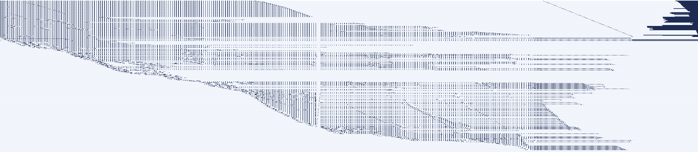

# Brick Breaker on a Billiard Ball Computer

**Play it in your browser: https://alexjhuang.github.io/billiard-breaker/** (the
machine runs on your computer, on one CPU core at ~4 frames/s; a button tries
the experimental WebGPU engine).

A playable brick-breaker game whose entire game logic is computed by billiard
balls: a Margolus billiard-ball-model cellular automaton (BBMCA). The frontend
only adds balls at input ports (your keys, plus a fixed schedule of "power"
balls that is the same every frame), deletes balls that leave the world, and
reads where the state balls are. Every frame of game state is computed by
balls bouncing off mirrors and each other.

The game has the arcade Breakout rules (SPEC.md): the four brick rows score
7, 5, 3 and 1 points (red, orange, green, yellow); the ball starts slow and
speeds up after the 4th and 12th brick, and when it hits an orange or a red
one; once it gets through to the ceiling the paddle shrinks to half; clearing
the wall brings a second one, and clearing that wins (256 points). Three
lives. Ball speed is a cadence: the ball moves on 1/2, 5/8, 3/4 or all of the
frames, so the machine's frame rate sets the pace.

```
python3 game_machine.py     # compile the game into mirrors + a ball schedule (build/, ~10 s)
python3 play.py             # play it (a/d or arrows, r reset, q quit; terminal >= 66x35)
python3 web.py              # or in a browser, next to a live view of the machine: http://localhost:8000
python3 play_oracle.py      # the same game in plain Python, for comparison
python3 tests/run_all.py    # all tests, incl. the 20 x 1000-frame differential test (~6 min)
python3 difftest.py 1000 20 # billiard machine vs reference, 20 x 1000 frames
```

Needs Python 3.12 (stdlib only) and gcc, which builds the C simulator on first use.

## In a browser


`python3 web.py` serves a page with two panels side by side, filling the window.

- **The game** (left), drawn with canvas graphics from the state the machine
  reads out each frame. Keys are sent while held, so the paddle moves on every
  frame you hold them.
- **The billiard-ball computer** (right). The world is a loop, so it is drawn
  as a ring: angle = position along the loop, radius = height in the band. The
  faint texture is the 2.7 M mirror cells. Every moving ball is drawn at its
  real position, coloured by direction: data lanes, falling gate messengers,
  and jogs. The pictures come from the frame being computed while the game
  shows the previous one. A frame is 71 396 steps, about 1/8 s, too fast to
  watch, so by default it works like a stroboscope. Each picture is a real
  moment of the current frame, a little later in the frame than the last one,
  so the computation front sweeps around the ring once every 8 s (slider: 1–32 s
  or real time).
- **The microscope** (centre) replays 16 real consecutive steps from ≤ ~0.5 s
  ago at 40 steps/s: balls, mirrors, and messengers hopping past lanes.
  Clicking the ring picks a depth, and the microscope then follows the gate
  messenger falling through that depth. Click "follow gates" to pin a spot
  instead. The mouse wheel zooms.

The server (`web.py`, stdlib only) runs the same C simulator as `play.py`.
Frames and ball positions stream to the page as server-sent events, and keys
come back as POSTs. Neither the server nor the page contains any game rules.
tests/test_web.py checks the frames against the oracle, and checks that every
picture matches a separate replay of the machine at the stated steps. Measured
here: ~22 frames/s at ~45 ms of compute per frame on 16 threads (8.7 on one),
~115 KB/s per viewer; the `--fps` cap is 30. The simulator does not step free flight, so the ball positions in
the pictures are extrapolated to the requested steps, not stepped to them.

To use it from another computer: `ssh -L 8000:localhost:8000 <host>`, or
`python3 web.py --host 0.0.0.0`. Everyone watching shares one game. The
machine pauses while nobody is connected.

**Static version (GitHub Pages).** `python3 web.py --export DIR` writes the
same page plus the hardware as data and two engines that run the machine in the
visitor's browser, in a Web Worker: `web/engine.js`, a JavaScript port of the C
simulator, on one CPU core (the default), and `web/gpu.js` on the GPU through
WebGPU (the button, or `?gpu`; experimental). The page says which one is
running and how long a frame takes, on the GPU too when the browser has
timestamp queries.

- *CPU.* 3.7 frames/s under Node on this machine (274 ms per frame; the old
  stepping engine took 171 ms per frame on the old, 40% smaller machine).
  tests/test_engine.py checks it against the C simulator.
- *GPU.* The C simulator's tiles on the GPU: 16 workgroups of 64 threads, each
  holding the balls of a range of x−y plus a light-cone margin, step them 64
  times per dispatch (the Margolus rule on each ball's block, all balls at
  once, the cells in rotating hash sets in on-chip memory: two barriers a
  step) and write back the balls that ended in their range; the next dispatch
  re-cuts the band into equal counts. The mirrors are two read-only bitmaps
  (160 MB) with one-bit-per-word summaries, read only when a ball's direction
  changes and a step ahead. A frame is 1116 dispatches in one command buffer
  and one readback. tests/test_gpu.py checks it against the JS engine on
  Chromium's software WebGPU adapter (the only WebGPU here): identical states,
  flags and recorded balls. **Speed on a real GPU**: the one-workgroup
  predecessor ran at 0.7–2 frames/s on an RTX 5060 Ti, all of it GPU time
  (DECISIONS.md has the diagnosis); this version is not measured yet. A frame
  has an event in 71 131 of its 71 396 steps, so no engine can skip steps:
  60 frames/s needs 233 ns a step. `?tiles=N&epoch=D` tune the engine,
  `?spin=N` adds busy workgroups to test whether the card idles at low clocks.

Published at https://alexjhuang.github.io/billiard-breaker/ from the
`gh-pages` branch (data files are versioned by content, so a cached page never
loads another build's machine). To update it:

```
python3 web.py --export /tmp/site && cd /tmp/site && git init -q -b gh-pages && git add -A \
  && git commit -qm "site" && git push -f git@github.com:alexjhuang/billiard-breaker.git gh-pages
```

## How it works

**Physics (sim.py, physics.py).** The world is a grid of cells updated in
2x2 blocks whose alignment alternates every step. A lone ball moves to the
opposite corner (so it flies diagonally), two balls on a diagonal turn to the
other diagonal, and everything else stays put. Static walls are 2x2 squares of
balls at the right parity. A single ball hitting a wall just bounces back, so
a signal is a *dimer*: two balls on one diagonal, two cells apart. It reflects
90° off a 2-thick bar. Two dimers crossing at right angles with exactly the
same timing collide cleanly: each hops to the neighbouring parallel track. Off
by 2 steps they shatter, and 4 or more steps apart they pass straight through.
physics.py has exact formulas for mirrors, collisions and mirror ends, all
re-checked against the automaton in tests/test_physics.py.

**The gate (layout.py).** Each gate is a falling *messenger* dimer with gap 6
(a power ball). It hits control lane X, which always hops (X survives and can
be read again), and the messenger hops only if X was there. It then meets data
lane R, lined up so they collide only if the messenger hopped. R's two
possible tracks are split apart by the end of a short mirror. The outputs are
X, R∧X and R∧¬X: Fredkin's switch gate. With R a power ball it gives copy and
NOT. Every gate in a frame uses this single construction.

**The world (cyl.py).** The world is a band wrapped into a cylinder along the
direction lanes travel, so state lanes simply circle back to the start of the
next frame. The two edges of the band are the sources and sinks. Lanes move
along the loop; messengers fall across it.

**Timing.** All lanes rest on a lattice of rows (y − t ≡ 0 mod 28). A gate
delays its control and data lanes onto the messenger's row with small detours
(two jogs) and puts them back afterwards; idle lanes take a 28-row detour in
every slot to stay in step. Every unplanned crossing between a falling ball
and a lane is then at least 8 rows away from any offset that would shatter.
A slot holds up to three gates at different *levels*, lattice offsets of 28
rows: a messenger only interacts with lanes at its own level, and lanes are
delayed to their gate's level by ordinary 28-row bumps (DECISIONS.md).

**The compiler.** hw/game.py writes the frame step as boolean logic (frozen
games are handled by gating every cause of change; the brick decoder is a
switch tree). hw/lower.py turns it into switch gates. plan.py gives each gate a
slot along the loop and every signal a line, and enforces that messengers
fall: a gate's data lane must sit below its controls, inserting copies where
needed. Gates are list-scheduled into slots, longest remaining path first.
Next-state values therefore drift down the band and are lifted back to their
state lines as soon as they are final; the lifts' debt is paid in a tail of
narrow idle slots. compile.py turns slots into mirrors and the per-frame ball
schedule; hardware.py exports just that.

**The simulator (csim/bbm.c).** Exact and event-driven: free flight is not
stepped. Only 3% of the automaton's block updates do anything (a lone ball
just moves to the opposite corner), so every ball is kept as a straight line
(position at its last event, direction) and the simulator jumps to the next
step at which its 2x2 block holds something else. The next wall is found by
scanning the three bitmap rows in front of the ball, word by word (the walls
are stored twice, as rows of constant x−y for SE/NW movers and of constant
x+y for NE/SW movers). The next ball is found through an index on the
coordinate two directions keep in common: two balls both moving right keep
their x−t, so they can only ever share a block if those are within 1; likewise
y−t, x+t, y+t, and x−y or x+y for head-on pairs. The meeting step is then
solved in closed form. Events are popped from a heap, grouped by block, and
the Margolus rule is applied to the block as usual. Results are identical to
the stepping simulators (tests/test_fastsim.py checks dense random patterns
against cyl.py). One core now does what 16 tile threads did with the stepper,
and positions at any step are extrapolated for free, which is what the
browser's ring view uses. web/engine.js is the same engine in JavaScript.

On threads (`play.py`, `web.py`: 16 by default, `--threads N`) the band is cut
across (by x−y) into ranges of equal ball counts; each thread runs its range
plus a light-cone margin of 2·64+4 rows as a private event-driven world for 64
steps, keeps the balls that end in its range (exact, nothing moves faster than
2 rows a step), and only the margins are refreshed between epochs. The gain is
bounded by geometry: the live balls fill only ~2 200 rows of the band at a
time, so the margins redo 1.7x the real machine's events (DECISIONS.md).

| Whole frame (u along the loop, v up the band; dark = mirrors) |
|---|
|  |

The block on top is every live lane taking its idle detour in each slot.
Values drift down the band as the computation proceeds, and the lifts at the
right bring next-state values back up. `docs/slot.png` zooms in on one gate.

## Measured (this machine: 192 cores, shared with other users)

| | |
|---|---|
| frame rate, `python3 play.py --bench 40 --threads 16` (the default) | **22.3 frames/s** (load average ~50) |
| frame rate, `--threads 1` | 15.9 frames/s (63 ms per frame) |
| in the browser, CPU engine (web/engine.js under Node) | 6.9 frames/s (144 ms per frame) |
| in the browser, GPU engine (web/gpu.js, 16 tiles) | not measured here (no GPU); exact on the software adapter; the one-workgroup version did 0.7–2 frames/s on an RTX 5060 Ti |
| world | cylinder 27 398 × 11 941 (u × x−y): 327 M cells |
| frame period P | 45 990 automaton steps (71 396 with one gate per slot) |
| events per frame | 251 k blocks with more than a lone ball; 334 k ball reschedules (518 k / 686 k with one gate per slot); ~427 balls moving on average, 620 at most |
| gates | 776 switch gates + 87 copies = 863 messengers per frame |
| slots | 664 (3 input, 340 gate slots holding 1–3 gates each, 1 lift, 320 catch-up) |
| mirrors | 161 383 bars (1.3 M wall cells) |
| balls added per frame | 1259 (863 messengers, 393 power, 3 key inputs) |
| lanes alive | ≤ 294 lines; ~427 moving balls on average |
| tiles (layout primitives placed) | 863 messengers, 863 splitters, 396 power/input sources, 464 drops, 39 898 retimes (an up-jog and a down-jog each) |

Before the arcade rules (488 gates, P = 43 456, 160 M cells): the event-driven
simulator did 63 ms per frame on one core, against 125 ms stepping serially
and ~60 ms stepping on 16 tile threads.

## Verification

- `tests/run_all.py`: physics formulas vs the automaton; every layout primitive
  and a full gate slot (all inputs, both gate orientations); small circuits
  (counter, 4-bit accumulator, keep-both gates) frame by frame vs the gate-level
  simulator; the game logic and the switch netlist vs the reference on random
  states; the event-driven C simulator vs the Python stepping simulators on
  dense random patterns; the JavaScript engine vs the C simulator; play.py's
  frames vs the reference, a check that play.py never imports game logic, and
  a terminal smoke run; and the differential test below (tests/test_difftest.py:
  20 sequences × 1000 frames, plus 2 bot games of 2400 frames that must each
  clear both walls and win).
- `difftest.py`: the billiard machine against `oracle.py`, bit for bit, state
  and win/lose flags every frame. Last full run on the current build:
  20/20 sequences × 1000 frames and 2 × 2400 frames with full wins (256
  points each, the bot games on 4 tile threads); log in build/tests_tiles.log.

## Known limitations

- The event-driven simulator's cost is set by the layout, not by free flight:
  every lane detours in every slot, so a ball has an event every ~32 steps.
  Shortening the frame means fewer slots, i.e. fewer idle detours; three gates
  per slot took P from 71 396 to 45 990.
- The frame's tail (320 idle slots, 39% of P) is the debt of lifting next-state
  values back up: a value produced 200 lines deep owes ~290 slots (1.43 a line).
- Threads give 2.5x, not 16x: the light-cone margins redo 1.7x the real
  events because the live balls occupy a narrow part of the band, and the
  epoch barriers (1 116 a frame) cost on a shared machine.
- The arcade rules cost 60%: 776 gates instead of 488, 184 lines instead of
  150, so P grew from 43 456 to 71 396 steps and the frame rate halved. At
  the base speed the ball moves every other frame, so at ~8 frames/s it
  crosses the field in ~8 s; the game is meant to be played at 15+ frames/s.
- Display lags input by one frame, and win/lose flags lag the state by one
  frame (they are computed from the frame's input state).
- The circuit runs gates one per slot. Ideas that would shorten the frame
  further but did not pay off yet are in DECISIONS.md: packing several gates
  per slot with lazy timing, and splitting the loop into parallel strips.

## What I'd do next

- Shorten the frame: lanes now all detour together in every slot, so P grows
  by 28 steps per gate and every lane costs ~12 events per slot. Letting lanes
  keep their own timing and packing independent gates into the same slot
  would cut both P and the event count several-fold.
- Better tiles: cut the band by predicted events rather than ball counts
  (tiles differ 1.4–1.75x in work), and re-cut every epoch.
- Measure and tune the GPU engine on real hardware: the wall scans are the
  only global memory traffic per step; halving the bitmaps (cells have
  x+y ≡ x−y mod 2) and prefetching the scan words would cut their latency.
- The arcade's remaining features: angle from where the ball hits the paddle
  (needs a ball with more than one speed per axis), 8 brick rows, a 5-ball game.

## Layout of the repo

`SPEC.md` game rules · `oracle.py` reference game · `hw/` logic and lowering ·
`plan.py`, `compile.py`, `layout.py`, `physics.py` compiler · `sim.py`, `cyl.py`
Python simulators · `csim/bbm.c`, `fastsim.py` C simulator · `play.py`,
`screen.py` terminal frontend · `web.py`, `web/index.html` browser frontend, `web/engine.js` (CPU) and `web/gpu.js` (WebGPU) in-browser engines · `debug.py` fault finder · `difftest.py` differential test ·
`DECISIONS.md` design log · `PROGRESS.md` work log.
